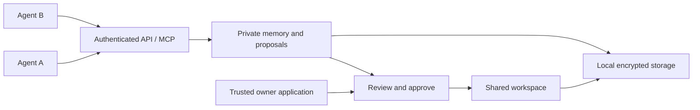

<p align="center">
  <picture>
    <source media="(prefers-color-scheme: dark)" srcset="docs/assets/dolphi-lockup.svg">
    
  </picture>
</p>

<p align="center">
  <a href="https://github.com/cogniolab/dolphi/actions/workflows/ci.yml"></a>
  <a href="LICENSE"></a>
  
  
</p>

<p align="center">
  <a href="docs/QUICKSTART.md">Quick start</a> ·
  <a href="docs/README.md">Documentation</a> ·
  <a href="docs/ARCHITECTURE.md">Architecture</a> ·
  <a href="CONTRIBUTING.md">Contribute</a> ·
  <a href="ROADMAP.md">Roadmap</a>
</p>

# Dolphi Community

**Give your agents memory, keep control of your data.**

Dolphi is an open-source memory database for AI agents. Each agent gets private
working memory. Shared changes go through a trusted owner. Your application
controls the database files, credentials and encryption keys.

Use the Rust library, local HTTP API, Python SDK or agent-only MCP bridge.
No model provider or cloud account is required.

> **Developer alpha.** APIs and formats may change. Sensitive production use
> still needs deployment-specific qualification and independent assessment.
> Read [security](SECURITY.md) and [current limits](docs/LIMITS.md).

## Why Dolphi?

An agent should remember its work while its application controls access and
shared decisions. Dolphi makes these responsibilities explicit:

| Need | Community provides |
|---|---|
| Remember work across sessions | Persistent, identity-scoped key/value memory |
| Separate private notes | Credential-derived identities and isolated namespaces |
| Share changes with oversight | Proposals, owner review and stale-version checks |
| Recover from uncertain responses | Durable operation IDs and scoped receipt lookup |
| Control access | Expiring credentials, revocation and logical quotas |
| Recover your data | Encrypted snapshots, verified restore and backend migration |
| Connect agent tools | Python SDK and five agent-only MCP tools |

An inventory agent can keep a supplier note private and propose a stock update.
A summary agent sees the approved stock value. The trusted owner decides whether
the proposal becomes shared state.

## Try the encrypted workflow

With a current stable Rust toolchain, C compiler, Make and Perl, clone the
Community repository and run the temporary example:

```sh
git clone https://github.com/cogniolab/dolphi.git
cd dolphi
cargo run --locked --no-default-features --features sqlcipher-backend --example community
```

This temporary example authenticates an agent, stores memory, approves a shared
change, revokes a credential and restores an encrypted backup under a new key.
Generated secrets are not printed or retained.

```text
PASS: authenticated agent memory and owner-approved changes
PASS: encrypted backup/restore with fresh credentials and a new database key
Dolphi Community protections ready for local evaluation
```

The default embedded profile runs the same example:

```sh
cargo run --locked --example community
```

The default uses the MIT-licensed Turso engine; its upstream page encryption is
experimental. The opt-in profile uses SQLCipher Community with pinned OpenSSL
sources. Both Dolphi profiles remain alpha. See [storage profiles](docs/ARCHITECTURE.md#storage-profiles).

For a persistent encrypted server and two-worker Python demo, follow the
[quick start](docs/QUICKSTART.md). Download the source, checksums and validation
report from [v0.1.0-alpha.1](https://github.com/cogniolab/dolphi/releases/tag/v0.1.0-alpha.1).
Cargo/PyPI packages and hosted services are not published by this alpha.

## A small Rust example

Inside trusted host code:

```rust,no_run
use dolphi::{EncryptionKey, Owner};

#[tokio::main]
async fn main() -> Result<(), Box<dyn std::error::Error>> {
    let key = EncryptionKey::generate()?;
    let owner = Owner::open_encrypted("agent-memory.db", &key, None).await?;
    let inventory = owner.create_agent().await?;
    inventory.remember("supplier-note", "Ask about Tuesday delivery").await?;
    let proposal = inventory.propose("stock", "12 units").await?;
    // Your trusted application presents this proposal for owner review.
    owner.approve(&proposal).await?;
    assert_eq!(inventory.read_shared("stock").await?.unwrap().value, "12 units");
    Ok(())
}
```

Persist the generated key securely before using a real persistent database;
this short example holds it only in memory. `Owner` is administrative authority.
External agents should use authenticated agent credentials through the API or
MCP bridge. See [trust boundaries](SECURITY.md).

## Connect an agent

The MCP bridge exposes five tools:

```text
memory_remember   memory_recall   shared_read   proposal_create   operation_status
```

Owner approval and administration stay in the trusted application. See
[HTTP API](docs/HTTP_API.md) and [Python/MCP setup](docs/PYTHON_AND_MCP.md).
Included workers are deterministic examples, without model/provider calls.

## How it fits together



Dolphi supplies memory schemas, authorization, review, quotas, audit and recovery
above existing storage engines. Operations currently serialize within a store.
Vector search, full-text search and distributed replication are not exposed as
Dolphi features. Read [architecture](docs/ARCHITECTURE.md).

## Community and Pro

Community is MIT-licensed. Authentication, basic encryption, quotas, durable
retries, backup/restore and the SDK/MCP interfaces are Community features.

Dolphi Pro is a planned managed offering focused on hosting, operations,
organization administration and support. No Pro service, pricing or availability
is announced here. See [Community/Pro principles](docs/COMMUNITY_AND_PRO.md).

## Help build Dolphi

Start with [CONTRIBUTING.md](CONTRIBUTING.md) and the
[development checks](docs/DEVELOPMENT.md). Corrections, examples, recovery tests
and documentation are useful first contributions. Please read the
[code of conduct](CODE_OF_CONDUCT.md). For help, see [SUPPORT.md](SUPPORT.md).
Report vulnerabilities privately using [SECURITY.md](SECURITY.md).

## License and acknowledgements

Dolphi's original code is [MIT-licensed](LICENSE), copyright Cognio Lab.
Third-party components retain their own licenses. We acknowledge Turso, SQLite,
SQLCipher, OpenSSL and the Rust ecosystem; see [notices](THIRD_PARTY_NOTICES.md).
